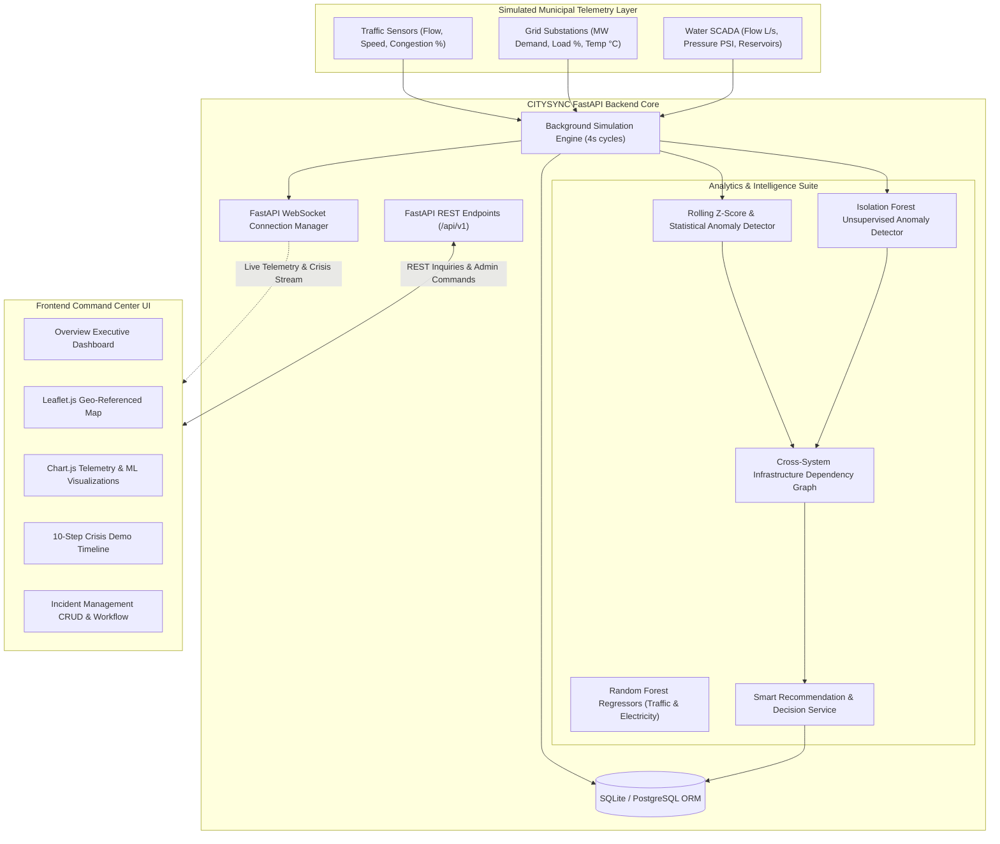

# CITYSYNC – System Architecture & Technical Specification

## 1. Executive Architectural Overview

**CITYSYNC** is an enterprise-grade Smart City Intelligence, Monitoring & Predictive Decision Platform engineered to resolve the core urban dilemma: **"A City Out of Sync"**. 

In conventional municipalities, Traffic Control, the Electrical Power Grid, and Municipal Water Distribution operate in siloed departmental vacuums. When a perturbation occurs in one domain (e.g., a power feeder trip or an arterial multi-lane collision), traditional monitoring systems fail to model the downstream consequences. CITYSYNC introduces a **Centralized Cross-System Intelligence Engine** that connects real-time telemetry, evaluates dependency graphs, and delivers actionable decision-support advisories before urban failures cascade.

---

## 2. Subsystem Architecture

### 2.1 Backend Core (Python 3 & FastAPI)
- **FastAPI Framework**: High-performance asynchronous API framework utilizing ASGI architecture with `uvicorn`.
- **SQLAlchemy 2.0 ORM**: Clean separation of data models, database sessions, and connection pooling. Configured for SQLite with WAL mode and foreign key enforcement; fully compatible with PostgreSQL.
- **Pydantic Validation**: Strict schema typing, input validation, and serialization.
- **Role-Based Access Control (RBAC)**: JWT bearer token authentication with role enforcement (`admin`, `traffic`, `electricity`, `water`).

### 2.2 Machine Learning & Predictive Analytics (`backend/ml/`)
- **Traffic Random Forest Regressor**: Predicts road segment congestion level (%) based on hour of day, rush-hour indicators, historical lag congestion, and vehicle volume.
- **Electricity Random Forest Regressor**: Forecasts grid power demand (MW) based on diurnal cycles, ambient temperature cooling load, and industrial shifts.
- **Utility Isolation Forest**: Unsupervised recursive isolation tree ensemble identifying multivariate anomalies across water flow, distribution pressure, and hydraulic ratios.
- **Uncertainty Quantification**: Point predictions supplemented by empirical 90% confidence envelopes ($\hat{y} \pm z \cdot \sigma_{\text{trees}}$).

### 2.3 Cross-System Dependency Engine (`backend/app/services/cross_system_engine.py`)
- **Dependency Topology Graph**: Encodes physical infrastructure relationships:
  - Substation $\to$ Water Pumping Station (Power Feed)
  - Arterial Corridor $\to$ Emergency & Utility Depot (Transit Access)
  - Water Trunk Mains $\to$ Subsurface Road Base (Pavement Stability)
  - Distribution Mains $\to$ Civic Fire Hydrant Network (Fire-Flow Pressure)
- **Cascade Evaluation**: When telemetry trips an anomaly threshold, the engine evaluates affected downstream nodes, projects consequence delays (in minutes), assigns cascading severity, and pushes actionable intervention plans.

### 2.4 Real-Time WebSockets (`/ws/live`)
- Maintains bi-directional persistent connections to all connected command center clients.
- Periodically pushes 4-second telemetry cycles.
- Broadcasts instant anomaly alerts, incident transitions, and crisis demonstration timeline steps.

### 2.5 Modern Command Center Interface
- Single-page application designed with HTML5, CSS3, Vanilla JavaScript.
- Interactive Leaflet.js with OpenStreetMap dark tiles and custom SVG pulse pins.
- Chart.js telemetry charts, sparklines, and confidence envelope graphs.
- 10 full navigation views with zero placeholder pages.
