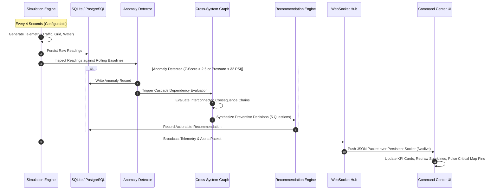

# CITYSYNC – Real-Time Data Flow & Cascading Intelligence Pipeline

## 1. End-to-End Data Pipeline Architecture

---

## 2. Telemetry Processing & Anomaly Scorer

1. **Ingestion & Historical Buffering**:
   - Telemetry from each sensor node is buffered into rolling windows (last 40 readings).
   - Moving mean $\mu$ and standard deviation $\sigma$ are updated dynamically.
2. **Statistical Scoring**:
   - $Z = \frac{x - \mu}{\max(1.0, \sigma)}$
   - If $|Z| \ge 2.6$ or physical threshold violated (e.g. pressure $< 32$ PSI, grid load $\ge 90\%$, speed $< 15$ km/h), an anomaly is synthesized.
3. **Cross-System Interconnect**:
   - If an electrical anomaly occurs in Sector 4, the engine looks up all downstream consumers (e.g., Water Pumping Station 2).
   - If an arterial traffic corridor has congestion $> 85\%$, the engine calculates response delay for emergency fleet vehicles dispatched from Sector 1 Maintenance Depot.
4. **WebSocket Broadcast**:
   - Every cycle transmits a unified packet containing updated nodes, new anomalies, active cross-system cascade chains, and KPIs.
