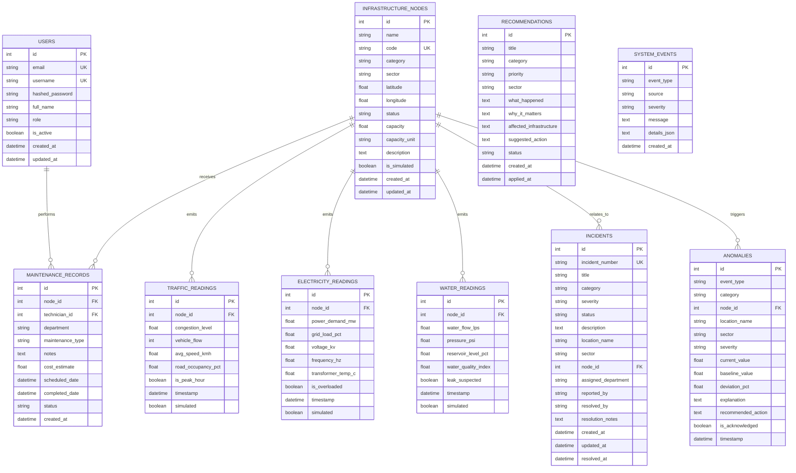

# CITYSYNC – Database Entity-Relationship (ER) Documentation

## 1. Database Model & Schema Design

CITYSYNC utilizes a relational database architecture managed through **SQLAlchemy 2.0 ORM**. While configured by default for SQLite for local zero-configuration development, the data types, foreign key constraints, and relational indexes are structured for instant deployment to PostgreSQL in high-throughput production environments.

---

## 2. Mermaid Entity-Relationship Diagram

---

## 3. Key Relationships & Integrity Constraints

1. **Infrastructure Telemetry Cascade**: `TrafficReading`, `ElectricityReading`, and `WaterReading` enforce `CASCADE ON DELETE` against `infrastructure_nodes.id`.
2. **Incident Tracking**: `Incident` models link optionally to `infrastructure_nodes.id` with `SET NULL ON DELETE` so historical municipal incidents are retained even if an asset is decommissioned.
3. **Database Indexes**: Indexed on `node_id`, `timestamp`, `category`, `status`, and `severity` to guarantee sub-millisecond query latency for live dashboards and time-series charts.
