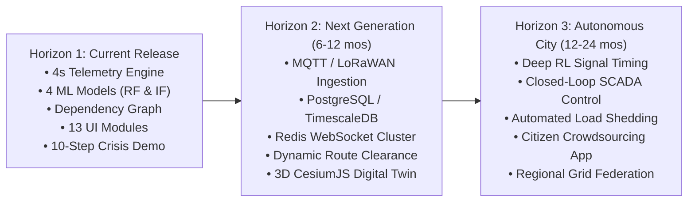

# CITYSYNC – Future Scope & Strategic Roadmap (CITYSYNC 2.0)

## 1. Vision Statement

CITYSYNC is envisioned to evolve from an intelligent municipal monitoring and decision-support command center into an **autonomous, self-healing urban operating system**. By uniting edge computing, physics-informed AI, and closed-loop actuation, CITYSYNC will empower cities to anticipate disruptions hours before they manifest.

---

## 2. Strategic Roadmap Horizons

---

## 3. Key Capability Enhancements

### 3.1 Industrial IoT Edge Ingestion (MQTT, LoRaWAN & OPC-UA)
- Connect real municipal sensors across LoRaWAN smart water meters, inductive loop vehicle counters, and smart grid meters.
- Deploy edge gateways running lightweight telemetry normalization engines that push data directly to CITYSYNC via TLS-encrypted MQTT brokers (EMQX / Mosquitto).

### 3.2 Time-Series Database & High-Throughput Analytics
- Migrate historical telemetry storage from relational SQLite/PostgreSQL to **TimescaleDB** or **ClickHouse**.
- Enable sub-second continuous aggregations, downsampling, and multi-year trend queries across millions of sensor data points without slowing down real-time command dashboards.

### 3.3 Photorealistic 3D Digital Twin (Three.js & CesiumJS)
- Transition from 2D Leaflet.js mapping to a geospatial 3D digital twin using CesiumJS and OpenStreetMap 3D building geometry.
- Visualize subterranean water distribution pipelines, overhead electrical transmission lines, and real-time vehicle movement meshes with dynamic thermal heatmaps.

### 3.4 Deep Reinforcement Learning for Adaptive Traffic Optimization
- Implement multi-agent Deep Q-Networks (DQN) or Proximal Policy Optimization (PPO) models to dynamically adjust traffic light signal cycles at key arterial intersections based on real-time vehicle queues and cross-system emergency vehicle routes.

### 3.5 Closed-Loop Autonomous SCADA Actuation
- Transition from advisory recommendations to safe, closed-loop actuation with operator approval gates:
  - *Automated Grid Switching*: Automatically isolate tripped transformer feeders and re-energize water pump substations via alternate redundant distribution circuits within 2 seconds.
  - *Dynamic Hydraulic Balancing*: Automatically throttle smart pressure-reducing valves (PRVs) upstream of detected water pipe bursts to mitigate roadway flooding and preserve drinking water reserves.

### 3.6 Citizen Engagement & Crowdsourced Reporting Mobile App
- Release a citizen mobile application (iOS & Android) allowing residents to submit geolocated photos of water main leaks, power outages, and traffic hazards.
- Computer vision pipeline automatically categorizes photos, cross-checks against sensor telemetry, and deduplicates incident creation.
