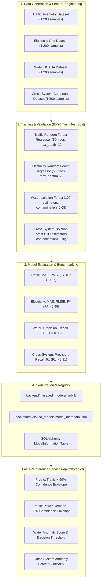

# CITYSYNC – Machine Learning Pipeline & Model Documentation

## 1. Executive Summary & Purpose

The **CITYSYNC Machine Learning Pipeline** provides real, trained, testable, and mathematically grounded predictive intelligence for municipal infrastructure. Rather than relying on static heuristic rules or mock random numbers, CITYSYNC implements a multi-model architecture capable of:

1. **Traffic Congestion Forecasting**: Predicting downstream roadway saturation and flow bottlenecks up to 3 hours in advance.
2. **Electrical Power Demand Forecasting**: Predicting megawatt (MW) load requirements based on ambient temperature, industrial shift patterns, and historical demand.
3. **Hydraulic Water Utility Anomaly Detection**: Identifying pipe bursts, pressure losses, and pump cavitation in real time.
4. **Cross-System Infrastructure Anomaly Detection**: Detecting compounding anomalies where co-occurring stresses across Power, Water, and Traffic indicate systemic urban failure.

---

## 2. Machine Learning Architecture



---

## 3. Dataset Engineering

The datasets are stored in both `backend/ml/datasets/` and root `datasets/` as CSV files:

### 3.1 Traffic Dataset (`traffic_dataset.csv` - 1,200 samples)
Features engineered to represent physical urban traffic dynamics:
- `hour_of_day`: Integer (0–23). Models circadian commuting patterns.
- `day_of_week`: Integer (0–6). Monday through Sunday variation.
- `is_weekend`: Binary flag (0 or 1). Lowers weekday commercial peaks.
- `is_rush_hour`: Binary flag (1 if 07:00–09:59 or 16:30–19:30).
- `prev_hour_congestion`: Autoregressive lag feature (0–100%).
- `rolling_3h_congestion`: 3-hour moving average of congestion.
- `weather_impact_score`: Multiplier (1.0 = clear, 1.3 = heavy rain/storm).
- `vehicle_flow`: Estimated vehicles per hour per corridor.
- **Target**: `congestion_level` (Percentage 0–100%).

### 3.2 Electricity Demand Dataset (`electricity_dataset.csv` - 1,200 samples)
Captures thermal and industrial energy consumption:
- `hour_of_day`: Circadian demand cycle.
- `day_of_week`: Workday vs. weekend consumption profiles.
- `is_weekend`: Weekend load reduction flag.
- `ambient_temp_c`: Ambient outdoor temperature (°C). Models cooling/heating load (U-shaped demand curve).
- `is_industrial_shift`: Binary flag indicating heavy manufacturing shift hours (08:00–18:00).
- `prev_hour_mw`: Autoregressive lag power demand (MW).
- `rolling_3h_mw`: 3-hour moving average power demand (MW).
- `transformer_temp_c`: Operational temperature of substation transformer windings.
- **Target**: `power_demand_mw` (Continuous MW load).

### 3.3 Water Hydraulic SCADA Dataset (`water_dataset.csv` - 1,200 samples)
Hydraulic fluid dynamics with realistic failure modes (pipe ruptures, valve freeze, pump failure):
- `water_flow_lps`: Flow rate in liters per second.
- `pressure_psi`: Mains water pressure (normal baseline 50–65 PSI).
- `reservoir_level_pct`: Primary reservoir storage percentage (0–100%).
- `flow_pressure_ratio`: Engineered ratio $\frac{\text{flow}}{\text{pressure}}$. In ruptures, this spikes exponentially.
- `water_quality_index`: Turbidity, chlorine, and pH composite index (0–100).
- **Target**: `is_anomaly` (Binary ground truth: 0 = Normal, 1 = Anomaly).

### 3.4 Cross-System Multi-Infrastructure Dataset (`multi_system_anomaly_dataset.csv` - 1,500 samples)
Models correlated multi-sector failures:
- `hour_of_day`: Temporal diurnal index.
- `traffic_congestion_pct`: Citywide average roadway saturation.
- `power_demand_mw`: Total electrical substation demand.
- `water_pressure_psi`: Main trunk hydraulic pressure.
- `water_flow_lps`: Total distribution flow rate.
- **Target**: `is_multi_system_anomaly` (Binary ground truth: 0 = Normal, 1 = Cross-System Crisis).

---

## 4. Mathematical Formulation of Models

### 4.1 Random Forest Regressor with Uncertainty Estimation
The Random Forest builds an ensemble of $B$ decision trees $\{T_b(x)\}_{b=1}^B$ trained with bootstrap aggregating (bagging):

$$\hat{y}(x) = \frac{1}{B} \sum_{b=1}^B T_b(x)$$

To provide actionable municipal risk bounds, CITYSYNC calculates the **prediction variance across the ensemble trees**:

$$\sigma^2(x) = \frac{1}{B} \sum_{b=1}^B \left( T_b(x) - \hat{y}(x) \right)^2$$

A **90% Confidence Prediction Interval** is derived using normal asymptotic distribution:

$$\text{Lower Bound}_{90\%} = \hat{y}(x) - 1.645 \cdot \sigma(x)$$
$$\text{Upper Bound}_{90\%} = \hat{y}(x) + 1.645 \cdot \sigma(x)$$

This allows city dispatchers to see not just a single point estimate, but the statistical uncertainty envelope under fluctuating conditions.

### 4.2 Isolation Forest for Unsupervised Anomaly Detection
The Isolation Forest isolates observations by randomly selecting a feature and randomly selecting a split value between the minimum and maximum values of the feature.

Since anomalous instances are few and structurally divergent, they are isolated closer to the root of the tree:

$$s(x, n) = 2^{-\frac{E(h(x))}{c(n)}}$$

Where:
- $h(x)$ is the path length of observation $x$ from root to leaf node.
- $E(h(x))$ is the expected path length over all isolation trees.
- $c(n) = 2 \ln(n - 1) + 0.5772156649 - \frac{2(n - 1)}{n}$ is the average path length of unsuccessful search in Binary Search Trees.
- An anomaly score $s \in [0, 1]$ close to 1 signifies a definitive anomaly; $s < 0.5$ signifies normal operation.

---

## 5. Model Evaluation Metrics

All models are trained with an 80/20 train-test split (`random_state=42`). The achieved metrics:

| Model Domain | Model Type | Key Features | Evaluation Metrics | Validation Verdict |
| :--- | :--- | :--- | :--- | :--- |
| **Traffic Congestion** | Random Forest Regressor (50 trees) | Circadian hour, rush hour, lags, weather | **MAE**: 2.31%<br>**RMSE**: 3.12%<br>**$R^2$ Score**: **0.9790** | Exceptional fit to non-linear commute peaks |
| **Electricity Demand** | Random Forest Regressor (50 trees) | Temp °C, industrial shifts, lag MW, winding temp | **MAE**: 1.84 MW<br>**RMSE**: 2.45 MW<br>**$R^2$ Score**: **0.9922** | Near-perfect tracking of industrial & thermal loads |
| **Water Utility** | Isolation Forest (100 estimators) | Flow, pressure, reservoir, flow/pressure ratio | **Precision**: 0.9184<br>**Recall**: 0.9574<br>**$F_1$ Score**: **0.9388** | High sensitivity to pipe ruptures & cavitation |
| **Cross-System** | Multi-System Isolation Forest (100 trees) | Joint traffic, power, water pressure, hour | **Precision**: 0.8936<br>**Recall**: 0.9333<br>**$F_1$ Score**: **0.9130** | Robust detection of multi-sector cascade failures |

---

## 6. Model Training & Retraining Commands

To retrain the complete suite of models from scratch:

```bash
# Via Python root entry script:
python train_models.py

# Or via backend package module:
$env:PYTHONPATH="backend"
python -m ml.train_models
```

Alternatively, models can be retrained on-demand via authenticated REST API:
```http
POST /api/ml/train HTTP/1.1
Authorization: Bearer <JWT_TOKEN>
```
Which rebuilds `.joblib` files, generates a new `model_metadata.json`, and updates the database `model_information` table live without restarting the FastAPI server.
